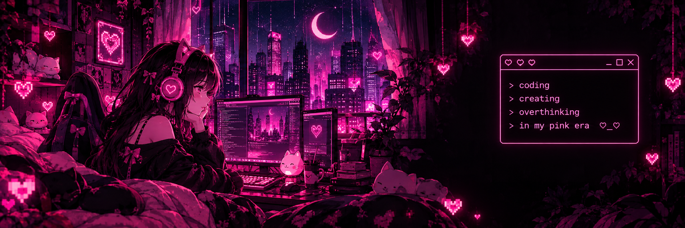

<!-- PINK NEON CYBERPUNK PROFILE -->

<div align="center">



<br/>


<p>
  
   
  
  
  
<a href="https://www.linkedin.com/in/hussnanasser-cs/">
  
</a>

</p>

<p><i>♡ turning ideas into something cute . . . ♡</i></p>

</div>

---

## 💗 About Me

```text
I’m in my second year at Bournemouth University, currently looking
for a placement for 2027,particularly in AI, Machine Learning, Data
Science or Data Engineering. I’d love to connect with others in these
fields and learn more about the industry ♡
```

- 🌸 Developer and student
- 💻 Exploring web development and creative coding
- 🎀 Interested in cute designs and digital experiences
- 💗 Always learning something new

---

## 🎀 Technologies I use

## 🎀 Technologies I use

<p align="center">
  
  &nbsp;
  
  &nbsp;
  
  &nbsp;
  
  &nbsp;
  
  &nbsp;
  
  &nbsp;
  
  &nbsp;
  
  &nbsp;
   
   &nbsp;
  
</p>

---

## 💖 GitHub Stats

<p align="center">
  
  
</p>

<p align="center">
  
</p>

---

## 🌸 Contribution Garden

<p align="center">
  
</p>

---

## 💗 Featured Projects

<table>
<tr>
<td width="33%" valign="top">

### ♡ Web Dev

**Coming soon**

Something cute is being built here 💗

`#web-dev`

</td>
<td width="33%" valign="top">

### ♡ Creative

**Coming soon**

New ideas, new projects, new magic 💗

`#creative`

</td>
<td width="33%" valign="top">

### ♡ In Progress

**Coming soon**

Stay tuned for something amazing 💗

`#in-progress`

</td>
</tr>
</table>

---

## 🎧 Currently Vibing

<p align="center">
  <i>pink + white ♡ Frank Ocean</i>
  <br/>
  
</p>

---

<div align="center">


<i>♡ thanks for visiting my little corner of the internet ♡</i>

</div>
